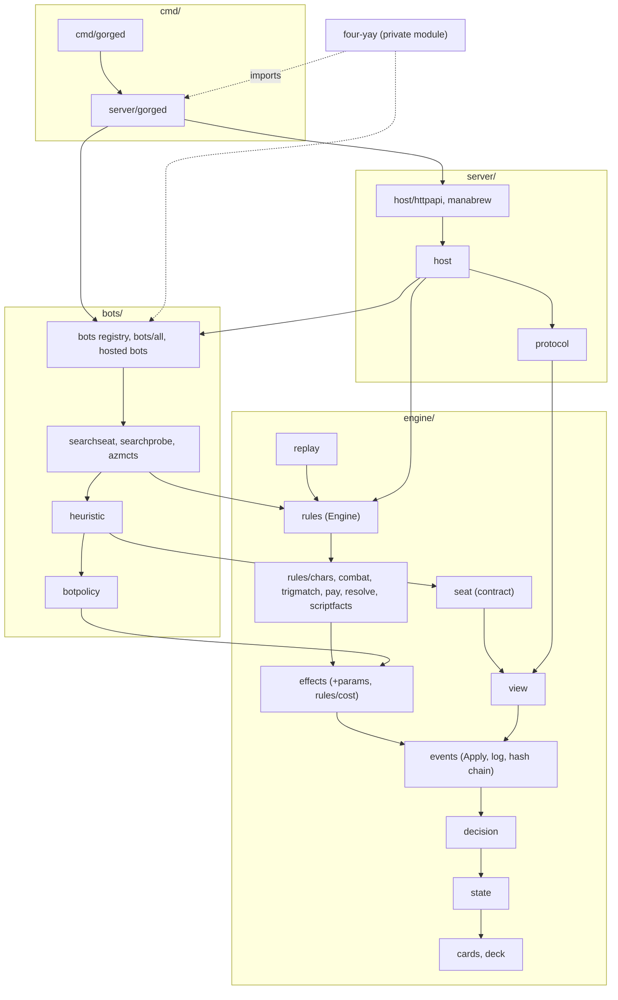

# Architecture overview

*Measured on `main` @ `6d95c6a54`, 2026-10-16, after the repository
restructure ([ADR 0001](https://github.com/adams-shaun/gorge/blob/main/docs/decisions/0001-repo-layout.md)),
from `go list ./...` and the import graph.*

## The core idea

Card behaviour is not hand-written per card. Forge's card scripts (fetched,
never committed) are compiled by the `engine/cards` package into an IR. The rules
core (`engine/state`, `decision`, `events`, `effects`, `rules`) implements the
primitives the IR references: `api:` effects, `trig:` trigger modes, `kw:`
keywords, `stat:` static abilities, `count:` value expressions and so on. A
card is *playable* when every primitive it uses is implemented.

All state mutation goes through `events.Apply`, which appends to a
SHA-256 hash-chained log. Combined with a seeded RNG and no wall-clock reads,
that makes a match a pure function of `(Config, intents)`:

- **replay** re-executes the log and stops at the first divergent event;
- **resume** after a restart is a replay;
- **undo** and **search clones** reuse the same machinery.

Players never see the engine. Each seat receives a redacted `view.View` and
answers a `decision.Decision` drawn from a closed set of kinds (priority,
targets, attackers, blockers, trigger order, modes, mulligan, and so on).

## Groups

The repository is grouped by audience. Each group imports only the groups
above it in this table.

| Group | Contents | Role |
|---|---|---|
| `engine/` | `cards` (+`oracletext`), `deck`, `state`, `decision`, `events`, `effects` (+`params`), `rules` and its sub-packages, `replay`, `view`, `seat` | T0 card pipeline (Forge script → IR) and T1 rules core, the per-seat projection, and the `Seat` contract (`seat` imports only `decision` and `view`) |
| `bots/` | `botpolicy`, `heuristic` (the default `Bot`, `BoardSeat`, `PolicyNetBot`), the registry (`bots`, `bots/all`), hosted bots (`bot`, `lethalpressure`, `sbtactical`, `azredeal`) and their inference runtime (`azmcts`, `gonet`, `policynet`, `sanity`, `searchprobe`, `searchseat`, `traceboard`, `spellbench/{builtins,payexec}`) | every bot a table can seat |
| `server/` | `gorged` (the importable server: `Main`, `Extensions`, `RegisterNetBot`), `host` (+`httpapi`, `manabrewhttp`), `protocol`, `manabrew`, `divergence` | tables, persistence, HTTP + SSE, the wire protocols |
| `testkit/`, `cli/` | `testkit/{testutil,bench,paymirror}` (test support and the game runner) and `cli` (the flag/env/config parser), public so outside modules can use them | test support, command-line plumbing |
| `internal/` | `archtest`, `corpusheap`, `codeshape`, `testbudget`, `tsgen` | architecture ratchets, generators |
| `cmd/` | `gorged` (a thin main over `server/gorged`), `forgec`, `repro`, `mtgsim`, `pkgmap`, `codeshape`, `testbudget`, ... | product and developer binaries; nothing imports a command |
| `web/` | the Svelte+Vite client | embedded into `cmd/gorged` |

Arrows point from an importer to the package it imports. The dashed edges
leave the repository: four-yay, a private companion module, imports gorge and
plugs its draft events, network bots and research bots in through
`server/gorged.Extensions`, `server/gorged.RegisterNetBot` and the `bots`
registry. gorge never imports it (ADR 0001, 2026-10-16 amendment). The
generated tier graph on the [Packages](packages.md) page is the authority.

## Size

About 374k lines of non-test Go and 630k lines of tests (2026-10-16, after
the research tree left). `engine/` is 281k / 533k of that; the `engine/rules`
directory alone is 130k non-test lines. `bots/` holds 46k / 41k, `server/`
27k / 40k.

## Observations

1. **The rules core is clean.** `go list -deps ./engine/rules` reaches 15
   in-repo packages, all under `engine/`. The dependency direction is enforced
   by `internal/archtest` (see [Invariants](invariants.md)).
2. **`botpolicy` is the shared board model.** It lives in `bots/` and imports
   only `engine/`; an architecture test forbids it from importing `view`,
   `rules` or `seat`. Every search seat uses it as the opponent and
   environment model.
3. **The engine no longer links bots.** The old `seat → policynet` and
   `seat → botpolicy` edges are gone: `engine/seat` is the contract only, and
   the concrete bots live in `bots/heuristic` and the hosted packages. The
   server reaches bots through the `bots` registry (`bots.Factory`).
4. **Extensions are linked from outside.** `cmd/gorged` links only gorge's
   own bots (`bots/all`); a downstream module builds its own `gorged` main
   over `server/gorged` to add draft events or more bots.

## Further reading

- [Packages](packages.md): every package with its purpose, size and status.
- [Invariants](invariants.md): the rules the engine relies on, and what
  enforces each.
- [ADR 0001: repository layout](https://github.com/adams-shaun/gorge/blob/main/docs/decisions/0001-repo-layout.md).
- The original M0 design spec (2026-09-03) is archived; see
  [`docs/design/ARCHIVE.md`](https://github.com/adams-shaun/gorge/blob/main/docs/design/ARCHIVE.md).
