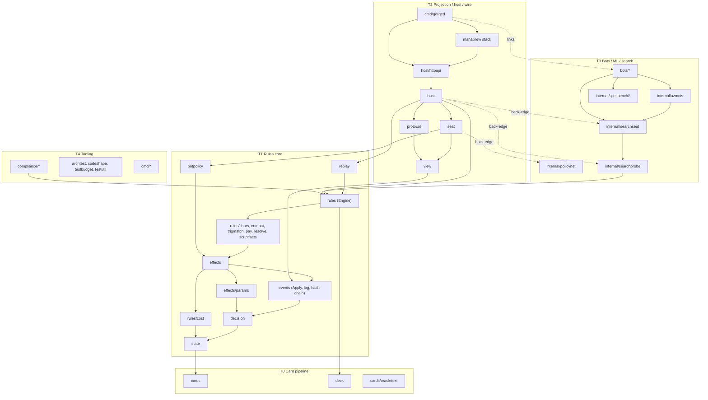

# Architecture overview

*Measured on `main` @ `f1ac002c4`, 2026-10-12, from `go list ./...` and the
import graph.*

## The core idea

Card behaviour is not hand-written per card. Forge's card scripts (fetched,
never committed) are compiled by the `cards` package into an IR. The rules
core (`state`, `decision`, `events`, `effects`, `rules`) implements the
primitives the IR references: `api:` effects, `trig:` trigger modes, `kw:`
keywords, `stat:` static abilities, `count:` value expressions and so on. A
card is *playable* when every primitive it uses is implemented.

All state mutation goes through `events.Apply`, which appends to a
SHA-256 hash-chained log. Combined with a seeded RNG and no wall-clock reads,
that makes a match a pure function of `(Config, intents)`:

- **replay** re-executes the log and stops at the first divergent event;
- **resume** after a restart is a replay;
- **undo** and **search clones** reuse the same machinery.

Players never see the engine. Each seat receives a redacted `view.View` and
answers a `decision.Decision` drawn from a closed set of kinds (priority,
targets, attackers, blockers, trigger order, modes, mulligan, and so on).

## Tiers

| Tier | Contents | Role |
|---|---|---|
| T0 card pipeline | `cards`, `deck`, `cards/oracletext` | Forge script → IR compiler, keyword expanders, card registry, coverage |
| T1 rules core | `state`, `decision`, `events`, `effects`, `rules` and its sub-packages, `replay`, `botpolicy` | the engine itself, plus the default heuristic bot (which search code uses as its environment model) |
| T2 projection / host / wire | `view`, `seat`, `protocol`, `host`, `host/httpapi`, the ManaBrew adapter stack, `cmd/gorged` | per-seat projections, decision answerers, tables, persistence, HTTP + SSE + the embedded Svelte client (`web/`) |
| T3 bots / ML / search | `bots/*`, `internal/policynet`, `internal/searchprobe`, `internal/searchseat`, `internal/azmcts`, `internal/spellbench/*` | hosted bot policies, learned policy plumbing, search harnesses |
| T4 tooling | `compliance/*`, `tools/xmageoracle`, `internal/archtest`, `internal/codeshape`, `internal/testbudget`, `internal/testutil`, ~40 `cmd/` binaries | the XMage compliance oracle, architecture ratchets, benchmarks |

Arrows point from an importer to the package it imports. Dashed edges are
*back-edges*: places where a lower tier imports research code from T3.

## Size

About 464k lines of non-test Go and 672k lines of tests. The rules core is
roughly 249k / 494k of that; the `rules` package alone is 124.5k non-test and
417.7k test lines across 379 and 2,148 files.

## Observations

1. **The rules core is clean.** `go list -deps ./rules` reaches 15 in-repo
   packages, all in T0/T1. The dependency direction is enforced by
   `internal/archtest` (see [Invariants](invariants.md)).
2. **`botpolicy` is effectively core.** 28 packages import it, and an
   architecture test forbids it from importing `view`, `rules` or `seat`. Every
   search seat uses it as the opponent and environment model.
3. **The production server links research code.** `cmd/gorged` links 41
   in-repo packages, including the MCTS, PIMC, learned-policy and SpellBench
   stacks, through two back-edges: `seat/policynet.go` → `internal/policynet`,
   and `host/botenv.go` → `internal/searchseat`. Decoupling these is on the
   [cleanup roadmap](cleanup.md). (The former `internal/policynet` →
   `internal/spellbench/v2agent` edge is cut: front end V moved to
   `internal/policynet/v2front`, and the SpellBench v1/v2 bridge builds only
   with `-tags spellbench_bridge`.)

## Further reading

- [Packages](packages.md): every package with its purpose, size and status.
- [Invariants](invariants.md): the rules the engine relies on, and what
  enforces each.
- The original design spec:
  [`docs/superpowers/specs/2026-09-03-mtgcore-go-engine-design.md`](https://github.com/adams-shaun/gorge/blob/main/docs/superpowers/specs/2026-09-03-mtgcore-go-engine-design.md).
