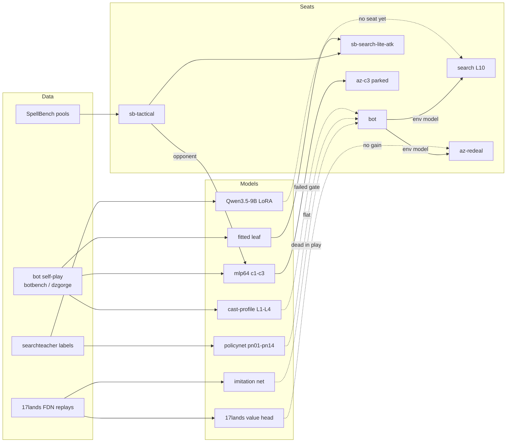

# Bots and learned policies

gorge hosts several bot policies, and has been used as an environment for
search and machine-learning experiments. This page inventories every path,
its status and its best measured result. *Compiled 2026-10-12 against `main`
@ `f1ac002c4` from recorded evaluations; dates are when each result was
measured. Win rates are against the named opponent with 95% confidence
intervals where recorded.*

## The finding so far

!!! abstract "Through-line, 2026-09-06 to 2026-10-10 (interpretation)"
    **Decision-time search is the only source of playing strength found so
    far.** Every attempt to distil search into a cheap policy (cast profiles,
    policy networks, imitation of human play, an LLM fine-tune) reproduced the
    heuristic bot rather than beating it. The strongest seats, the
    fitted-leaf `sb-search-lite-atk-fl` and the parked `az-c3` network-guided
    MCTS, win about 63–64% against `sb-tactical`, the strongest heuristic.

## Inventory

| Path | Code | Status | Headline result | Cost |
|---|---|---|---|---|
| `bot` default heuristic | `botpolicy/`, `bots/bot`, `seat/` | **live**; also the opponent and environment model inside every search seat | auto-pay attack simulation +3.17pp constructed / +3.69pp Commander | ~121 games/s per core |
| `lethal-pressure` | `bots/lethalpressure` | live, to be retired; plays identically to `bot` with manual taps | 24/24 identical games | same as `bot` |
| `cast-profile` L0–L4 | `bots/castprofile`, `botpolicy/profile.go`, `cmd/policytune` | **concluded** (failed its adoption gate) | 50.92% [49.38, 52.47]; the gate needed +3pp | cheap |
| `sb-uniform`, `sb-first` | `bots/sbuniform`, `bots/sbfirst`, `internal/spellbench/builtins` | live, as reference anchors | `sb-first` cannot finish 4-seat Commander | trivial |
| `sb-heuristic` | `bots/sbheuristic` | live; retirement recommended | ≈1080 Elo vs `bot` 1238 | cheap |
| **`sb-tactical`** | `bots/sbtactical` | **live; strongest heuristic** | held-out 1538 vs `bot` 1277 Elo; 0.687 [0.650, 0.724] vs `bot` on FDN (2026-10-08) | ~2.9M games/h on 12 workers |
| `search` (PIMC) | `bots/search`, `internal/searchseat`, `internal/searchprobe`, `cmd/searchteacher` | live, opt-in | 53.7% vs 50.4% control (+3.3pp), 2026-09-22; edge is early-game only | 664 ms mean / 2.2 s p95 per decision |
| `az-redeal` (MCTS) | `bots/azredeal`, `internal/azmcts` | live | 25 sims: 64.7% vs `bot`; 100 sims: 70.5%; loses to `sb-tactical` (32.2%); 400 vs 100 sims +4.4pp; exploration constant has no effect | 65.8 ms per decision at 25 sims |
| `sb-search-lite-atk(-fl)` | `bots/sbsearch` | live | 64.1% vs `sb-tactical`; fitted leaf +3.71pp held-out (n=1024, 2026-10-03) | 0.16–0.22 s per decision |
| Policy network: distillation, expert iteration, PPO (14 arms) | `internal/policynet`, `cmd/policytrain`, `cmd/exitloop`, `cmd/traindash` | **concluded**; plumbing merged behind flags | every arm reproduces `bot`; PPO stopped 2026-09-27 | ~4k-game evaluation per round |
| 17lands value head | unmerged branch | **concluded** | AUC 0.815 vs 0.833 for a head trained on own games | n/a |
| 17lands imitation | unmerged branch, `internal/azmcts/scoreopts.go` | **concluded in play** | ~0.65 dev accuracy; as a cast veto, −1.23 points | 2.3 h training |
| Flat-network imitation | unmerged branch | **concluded** 2026-10-08 | best 37.9% vs `bot` | n/a |
| MCTS + small MLP self-play (`az-c3`) | `cmd/dzgorge` on `main`; training and hosting on unmerged branches | **parked** 2026-10-09 | 0.630 [0.59, 0.67] vs `sb-tactical`; 185 ms mean per decision | 40 min self-play per generation plus GPU |
| LLM fine-tune (Qwen3.5-9B, SFT → DPO on search-teacher labels) | outside the repo | exploratory, no seat | DPO blend +0.0057 ± 0.0025 reward on held-out; SFT copies `bot` | ~4 h on 2 GPUs |
| DraftZero / MageZero replication | side branch; `cmd/dzgorge`, `cmd/dzbroker` (tag `broker`) | dormant since 2026-10-03 (inferred) | no play result recorded | 2 vCPU / 4 GiB + 1 GPU |
| SpellBench | `internal/spellbench`, `cmd/sbagent`, `cmd/sbv1agent`, `cmd/sbv2engine`, `cmd/sbv2shadow` | v1 merged; v2 parked on a branch | clairvoyant MCTS 1436, `bot` 1238, uniform 1000 Elo | n/a |
| Search benchmark (DraftZero experiment 3) | `cmd/searchbench`, `internal/searchbench` | done (2026-10-01) | fair search does not need hidden information; more simulations gave flat returns | 3.2 h |

## How the pieces connect

Dashed edges are models that did not produce a gain over the seat they
targeted.

## Evaluating a policy yourself

`cmd/botbench` plays seeded matches between registered policies and reports
win rates with confidence intervals (`-out json` for machine-readable
output). The adoption ladder, the evaluation protocol and the rules for
training code are in the repository README under
[*Bot player training and adoption guidelines*](https://github.com/adams-shaun/gorge/blob/main/README.md#bot-player-training-and-adoption-guidelines).
